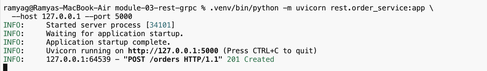
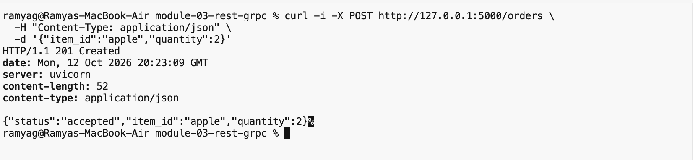
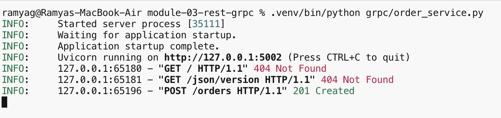
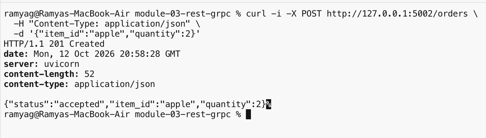
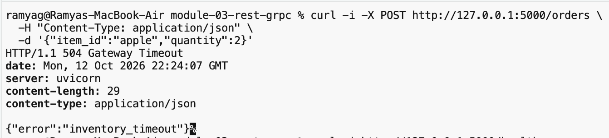
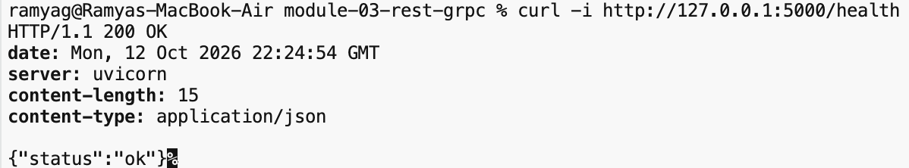
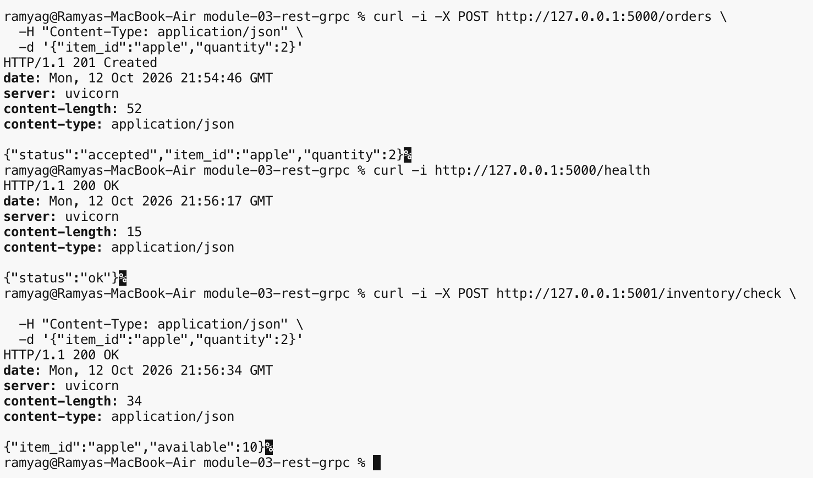
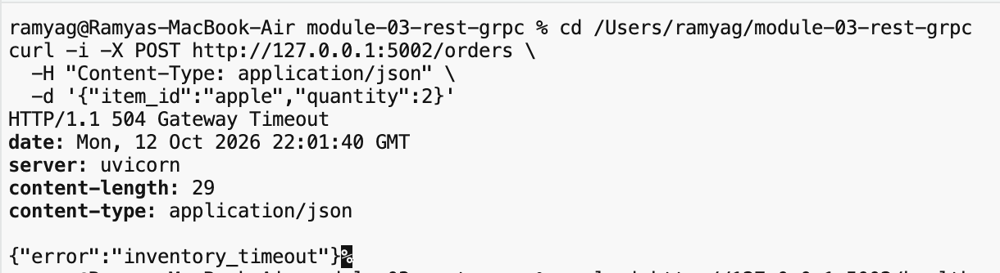
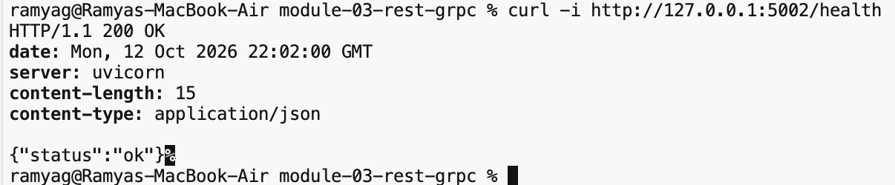
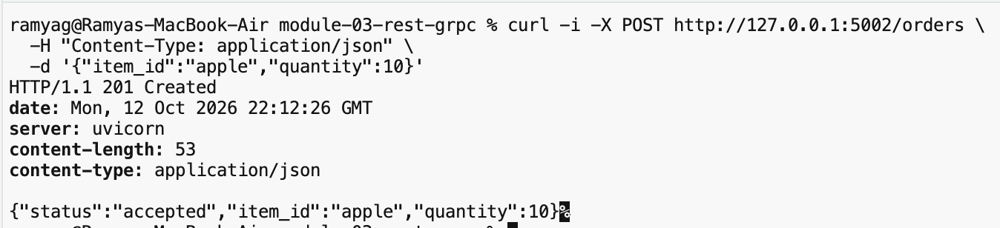

# Module 03 — REST and gRPC Service Contracts

An Order service asks an Inventory service whether a quantity is in stock. The same check is implemented twice, in separate processes: JSON over HTTP, and a protobuf RPC. Stock is fixed at apple 10 and banana 2. A successful check does not reserve or decrease stock. `INVENTORY_DELAY_MS` defaults to 0. Set it to 3000 to make the inventory check sleep longer than the 1.0 second REST timeout and the 1.0 second gRPC deadline.

## Folder structure

```
module-03-rest-grpc/
  README.md
  requirements.txt
  rest/
    __init__.py
    inventory_service.py
    order_service.py
  screenshots/
  grpc/
    __init__.py
    _grpc_runtime.py
    inventory_pb2.py
    inventory_pb2_grpc.py
    inventory_service.py
    order_service.py
    proto/
      inventory.proto
```

`rest/` is the HTTP pair. Inventory listens on port 5001. Order listens on port 5000. `grpc/` is separate. Inventory listens on port 50051. Order is an HTTP front end on port 5002 and a client of that RPC.

## Setup

From the project directory:

```bash
python3 -m venv .venv
.venv/bin/python -m pip install -r requirements.txt
```

`requirements.txt` lists fastapi, uvicorn, requests, grpcio, grpcio-tools, and protobuf. The generated stubs `grpc/inventory_pb2.py` and `grpc/inventory_pb2_grpc.py` are already in the tree.

## REST run commands

Two terminals, from the project directory. Leave `INVENTORY_DELAY_MS` unset for a normal check.

```bash
.venv/bin/python -m uvicorn rest.inventory_service:app --host 127.0.0.1 --port 5001
```

```bash
.venv/bin/python -m uvicorn rest.order_service:app --host 127.0.0.1 --port 5000
```

Timeout run, inventory terminal only:

```bash
INVENTORY_DELAY_MS=3000 .venv/bin/python -m uvicorn rest.inventory_service:app --host 127.0.0.1 --port 5001
```


## gRPC run commands

Two terminals, from the project directory. Leave `INVENTORY_DELAY_MS` unset for a normal check.

```bash
.venv/bin/python grpc/inventory_service.py
```

```bash
.venv/bin/python grpc/order_service.py
```

Deadline run, inventory terminal only:

```bash
INVENTORY_DELAY_MS=3000 .venv/bin/python grpc/inventory_service.py
```


## Successful REST request and response

Recorded from the REST run. `POST /orders` with `{"item_id": "apple", "quantity": 2}`:

```text
201 /orders {'item_id': 'apple', 'quantity': 2} -> {"status":"accepted","item_id":"apple","quantity":2}
```

The inventory check for that same item, `POST /inventory/check`:

```text
200 /inventory/check {'item_id': 'apple', 'quantity': 2} -> {"item_id":"apple","available":10}
```





## Successful gRPC request and response

Recorded from the gRPC order service. `POST /orders` on port 5002 with `{"item_id": "apple", "quantity": 2}`:

```text
201 /orders {'item_id': 'apple', 'quantity': 2} -> {"status":"accepted","item_id":"apple","quantity":2}
```





Although the external request uses `POST /orders`, the Order Service internally calls the Inventory Service using gRPC on port 50051.

## REST timeout evidence

Inventory was started with `INVENTORY_DELAY_MS=3000`. The order service was left running.

```text
timeout: {"error":"inventory_timeout"} HTTP 504
```



## Health check after the REST timeout

Same order process, immediately after the 504:

```text
health: {"status":"ok"} HTTP 200
```



## REST recovery evidence

Inventory was restarted with the default delay. The original order process was still running.

```text
order after recovery: {"status":"accepted","item_id":"apple","quantity":2} HTTP 201
stock: {"item_id":"apple","available":10} HTTP 200
```



## gRPC deadline evidence

Inventory was started with `INVENTORY_DELAY_MS=3000`. The gRPC order service was left running.

```text
deadline: {"error":"inventory_timeout"} HTTP 504
```



## Health check after the gRPC deadline

Same order process, immediately after the 504:

```text
health: {"status":"ok"} HTTP 200
```



## gRPC recovery evidence

Inventory was restarted with the default delay. The original order process was still running.

```text
order after recovery: {"status":"accepted","item_id":"apple","quantity":10} HTTP 201
```



## REST versus gRPC

Both versions answer the same stock question for apple and banana, and the order HTTP response for a successful apple order was `{"status":"accepted","item_id":"apple","quantity":2}` with HTTP 201 in both runs. REST carries the check as JSON to `POST /inventory/check` and uses a 1.0 second `requests` timeout. gRPC carries it as a `CheckInventory` protobuf call to port 50051 and uses a 1.0 second deadline, then maps `NOT_FOUND`, `FAILED_PRECONDITION`, `INVALID_ARGUMENT`, and `DEADLINE_EXCEEDED` onto HTTP 404, 409, 400, and 504. With `INVENTORY_DELAY_MS=3000`, both order services returned HTTP 504 and `{"error":"inventory_timeout"}`, then stayed up: `GET /health` returned `{"status":"ok"}`, and a later order was accepted after inventory was restarted with no delay. REST keeps the inventory contract in HTTP status codes and JSON, while gRPC keeps that contract in a protobuf service and status codes, with HTTP only at the order front end. Stock was unchanged by the failure and the later success: the REST recovery check still reported apple available 10, and the gRPC recovery accepted an order for all 10 apples.